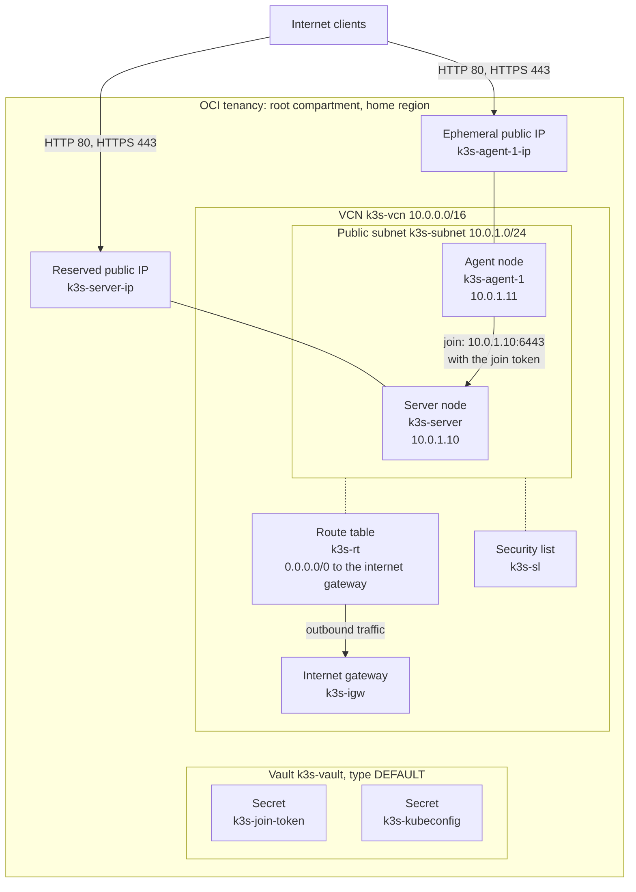
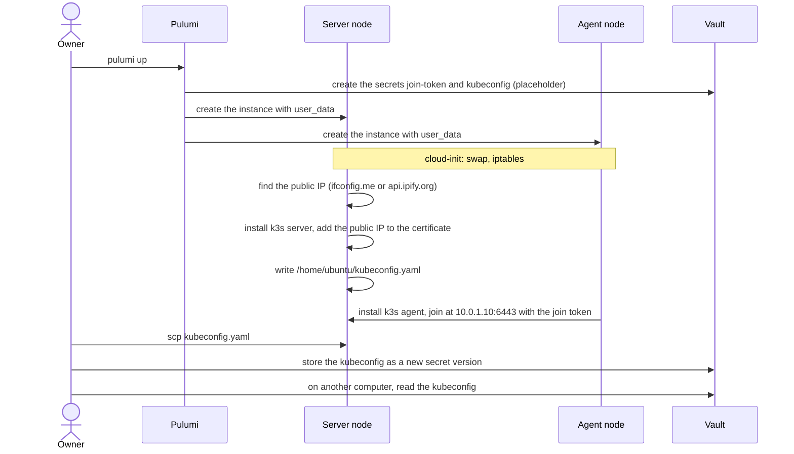

# Architecture

This document shows the parts of the project and how they connect. The diagrams use the default values of the stack configuration.

## Infrastructure in OCI

All resources are in the root compartment of the tenancy, in the home region. The nodes are in availability domain AD-1.

## First boot

cloud-init runs the bootstrap script `/usr/local/sbin/k3s-bootstrap.sh` once, at the first boot. The script is safe to run a second time.

