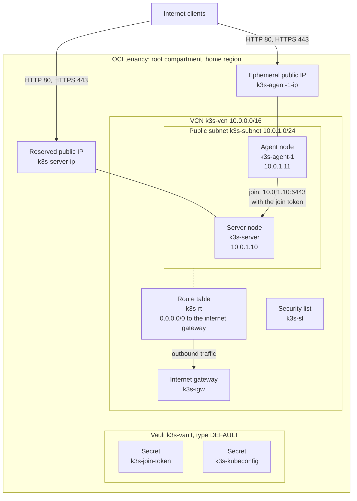
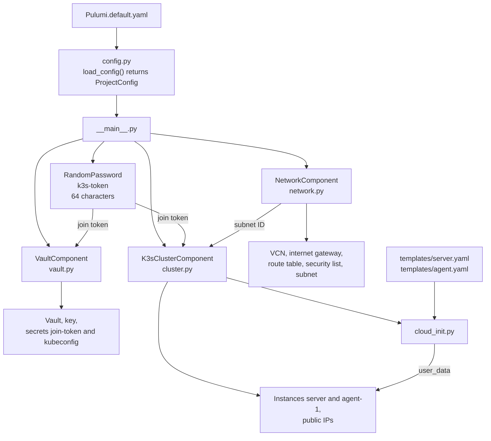
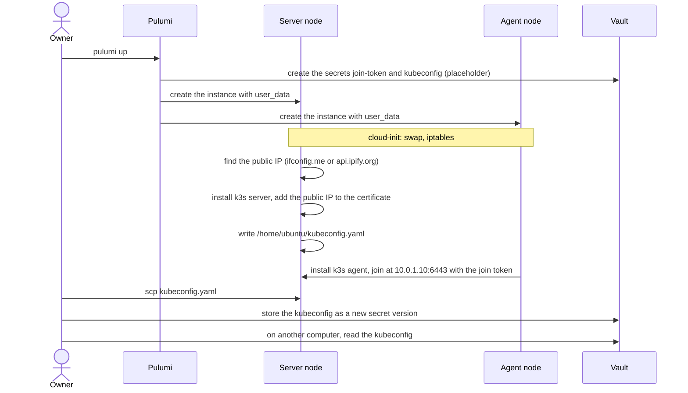

# Architecture

This document shows the parts of the project and how they connect. The diagrams use the default values of the stack configuration.

## Infrastructure in OCI

All resources are in the root compartment of the tenancy, in the home region. The nodes are in availability domain AD-1.

| Part | Why it is like this |
|------|---------------------|
| Reserved public IP on the server node | The API address stays the same after a replacement of the server node. The tenancy has 1 free reserved public IP. |
| Ephemeral public IP on the agent node | The agent node needs it for internet access. A NAT gateway is not free. |
| Fixed private IPs | The agent nodes find the server node at `https://10.0.1.10:6443`. |

[Network](NETWORK.md) describes the addresses, the routing, the DNS and the firewalls.

## Pulumi program

`__main__.py` reads the configuration once and creates three components and a random join token.

| Component | Type token | Stack outputs |
|-----------|------------|---------------|
| `NetworkComponent` | `oracle-cloud-k3s:network:NetworkComponent` | `vcn_id`, `subnet_id` |
| `VaultComponent` | `oracle-cloud-k3s:vault:VaultComponent` | `vault_ocid`, `join_token_secret_ocid`, `kubeconfig_secret_ocid` |
| `K3sClusterComponent` | `oracle-cloud-k3s:cluster:K3sClusterComponent` | `server_public_ip`, `agent_public_ips`, `api_server_url`, `ssh_user` |

### Configuration

The function `load_config()` in `config.py` reads the stack configuration and returns it as one `ProjectConfig` object. `__main__.py` gives this object to each component. The components do not read the stack configuration.

A value is in one of three places:

| Place | Values | Why |
|-------|--------|-----|
| `Pulumi.default.yaml`, required keys | Region, compartment, availability domain, SSH public keys | These values are different for each project. |
| `DEFAULT_*` constants in `config.py` | k3s version, CIDRs, private IPs, name prefix, API name, disabled k3s components, swap size | These defaults work for all. A key in `Pulumi.default.yaml` overrides a default. |
| Constants in the components | Shape, image OS, SSH user, API port, disabled Oracle Cloud Agent plugins | These are not options. A change can replace an instance. |

For `agent_private_ips` and `disable`, an empty list is a valid value. Only a missing key gets the default.

## First boot

cloud-init runs the bootstrap script `/usr/local/sbin/k3s-bootstrap.sh` once, at the first boot. The script is safe to run a second time.

