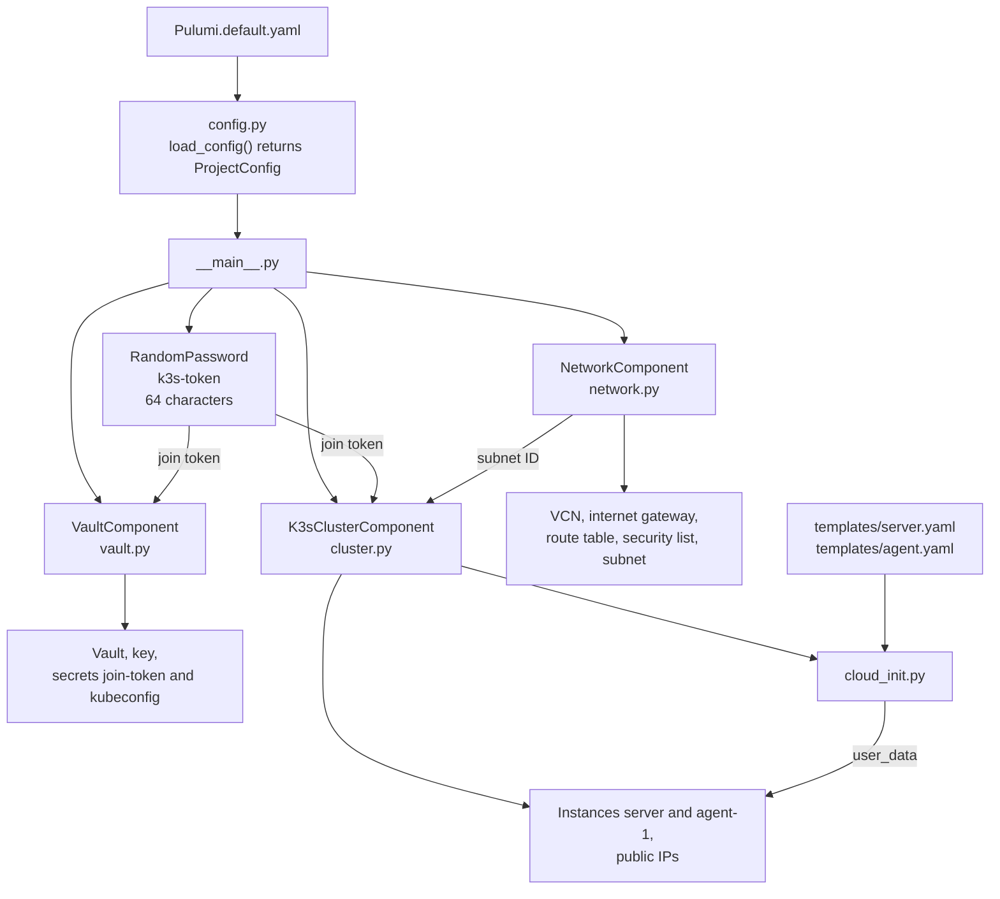

# Pulumi program

This document describes the Pulumi program in `pulumi/`: the components, the resources and the configuration.

## Overview

`__main__.py` reads the configuration once and creates three components and a random join token.

| Component | Type token | Stack outputs |
|-----------|------------|---------------|
| `NetworkComponent` | `oracle-cloud-k3s:network:NetworkComponent` | `vcn_id`, `subnet_id` |
| `VaultComponent` | `oracle-cloud-k3s:vault:VaultComponent` | `vault_ocid`, `join_token_secret_ocid`, `kubeconfig_secret_ocid` |
| `K3sClusterComponent` | `oracle-cloud-k3s:cluster:K3sClusterComponent` | `server_public_ip`, `agent_public_ips`, `api_server_url`, `ssh_user` |

## Components and resources

Pulumi has two kinds of resources:

| Kind | Example | What it is |
|------|---------|------------|
| Custom resource | `oci.core.Instance` | A real object in OCI. The OCI provider creates, updates and deletes it. |
| Component resource | `K3sClusterComponent` | A group of resources in the Pulumi state only. OCI does not know it. |

Each component is a subclass of `pulumi.ComponentResource`. It does these steps:

1. It registers itself in the state with its type token, for example `oracle-cloud-k3s:cluster:K3sClusterComponent`.
2. It creates its custom resources with `parent=self`. The parent groups them under the component in the state and in the preview.
3. It ends with `register_outputs(...)`. This marks the component as complete.

A component keeps one area of the infrastructure in one module. `__main__.py` connects the components through their outputs, for example the subnet ID.

## Configuration

The function `load_config()` in `config.py` reads the stack configuration and returns it as one `ProjectConfig` object. `__main__.py` gives this object to each component. The components do not read the stack configuration.

A value is in one of three places:

| Place | Values | Why |
|-------|--------|-----|
| `Pulumi.default.yaml`, required keys | Region, compartment, availability domain, SSH public keys | These values are different for each project. |
| `DEFAULT_*` constants in `config.py` | k3s version, CIDRs, private IPs, name prefix, API name, disabled k3s components, swap size | These defaults work for all. A key in `Pulumi.default.yaml` overrides a default. |
| Constants in the components | Shape, image OS, SSH user, API port, disabled Oracle Cloud Agent plugins | These are not options. A change can replace an instance. |

For `agent_private_ips` and `disable`, an empty list is a valid value. Only a missing key gets the default.
