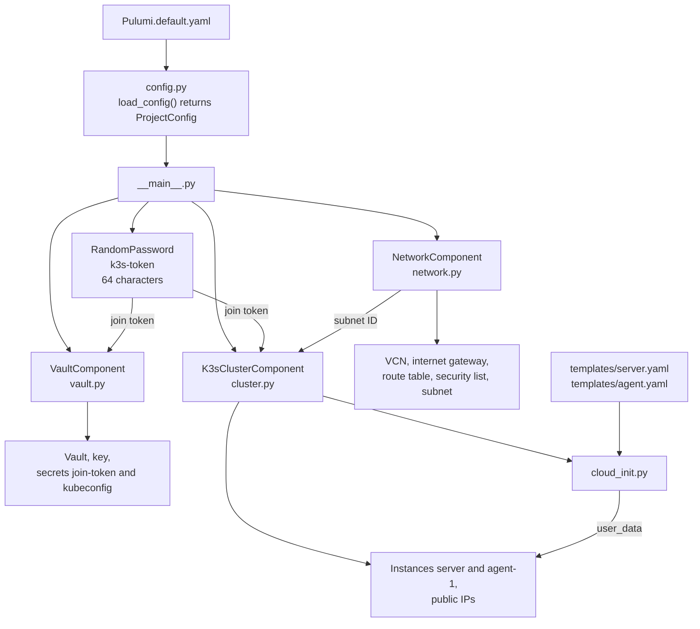

# Pulumi program

This document describes the Pulumi program in `pulumi/`: the components, the configuration, the outputs, the cloud-init and the cluster component.

## Overview

`__main__.py` reads the configuration once and creates three components and a random join token.

| Component | Type token | Stack outputs |
|-----------|------------|---------------|
| `NetworkComponent` | `oracle-cloud-k3s:network:NetworkComponent` | `vcn_id`, `subnet_id` |
| `VaultComponent` | `oracle-cloud-k3s:vault:VaultComponent` | `vault_ocid`, `join_token_secret_ocid`, `kubeconfig_secret_ocid` |
| `K3sClusterComponent` | `oracle-cloud-k3s:cluster:K3sClusterComponent` | `server_public_ip`, `agent_public_ip`, `api_server_url`, `ssh_user` |

## Components and resources

Pulumi has two kinds of resources:

| Kind | Example | What it is |
|------|---------|------------|
| Custom resource | `oci.core.Instance` | A real object in OCI. The OCI provider creates, updates and deletes it. |
| Component resource | `K3sClusterComponent` | A group of resources in the Pulumi state only. OCI does not know it. |

Each component is a subclass of `pulumi.ComponentResource`. It does these steps:

1. It registers itself in the state with its type token, for example `oracle-cloud-k3s:cluster:K3sClusterComponent`.
2. It creates its custom resources with `parent=self`. The parent groups them under the component in the state and in the preview. The parent is also part of the URN of each child: the ID with which Pulumi matches a resource in the code to the resource in the state. The children get options such as `provider` and `protect` from `opts` of the component.
3. It ends with `register_outputs(...)`. This marks the component as complete.

A component keeps one area of the infrastructure in one module. `__main__.py` connects the components through their outputs, for example the subnet ID.

## Configuration

The function `load_config()` in `config.py` reads the stack configuration and returns it as one `ProjectConfig` object. `__main__.py` gives this object to each component. The components do not read the stack configuration.

A value is in one of three places:

| Place | Values | Why |
|-------|--------|-----|
| `Pulumi.default.yaml`, required keys | Region, compartment, availability domain, SSH public keys | These values are different for each project. |
| `DEFAULT_*` constants in `config.py` | k3s version, CIDRs, private IPs, name prefix, API name, disabled k3s components, swap size | These defaults work for all. A key in `Pulumi.default.yaml` overrides a default. |
| Other constants in `config.py` | Shape, image OS, SSH user, API port, disabled Oracle Cloud Agent plugins, kubelet arguments | These are not stack configuration keys. A change can replace an instance. |

For `disable`, an empty list is a valid value. Only a missing key gets the default.

## Outputs and `apply`

`__main__.py` declares the join token as a `RandomPassword` resource. The Python program only declares resources. The Pulumi engine creates them later through the providers. Therefore the value of the token does not exist while the program runs.

`join_token.result` is a `pulumi.Output[str]`: a value that Pulumi knows later. `Output.apply(func)` calls `func` with the real value when Pulumi knows it. The result is again an `Output`.

An `Output` also carries:

- The dependency. A resource that uses the value waits for the resource that makes it.
- The secret flag. `RandomPassword.result` is secret, so every value made from it with `apply` is secret too.

The program creates one join token. The server node and the agent node get the same token.

## Cloud-init

`cloud_init.py` fills the templates `templates/server.yaml` and `templates/agent.yaml`. A placeholder has the form `@{name}`. A missing value stops the program with a `KeyError`.

In `cluster.py`, the function `cloud_init(render, node_ip)` makes the cloud-init of one node:

1. It calls `join_token.apply(with_token)`.
2. `with_token(token)` builds the `NodeParams` of the node and calls `render_server` or `render_agent`.
3. The result is the finished cloud-init file as an `Output[str]`.

`_instance()` encodes the file in Base64 and gives it to OCI as `user_data`. cloud-init runs it once, at the first boot.

## Cluster component

`K3sClusterComponent` creates the resources in this order:

1. The server node instance, then its reserved public IP.
2. The agent node instance, then its ephemeral public IP.

A public IP attaches to the private IP object of an instance. This object exists only after the instance exists, so the instance comes first.

| Method | What it does |
|--------|--------------|
| `_latest_image_id()` | Finds the newest Ubuntu 24.04 Minimal image for the micro shape. The program does not use it when `image_ocid` is set. |
| `_instance(role, private_ip, cloud_init)` | Creates one instance with a fixed private IP and no public IP |
| `_private_ip_id(instance, private_ip)` | Finds the ID of the private IP object of the instance |

The resource options:

| Resource | Option | What it does |
|----------|--------|--------------|
| Instance | `protect=True` | Pulumi does not delete the instance. |
| Instance | `ignore_changes=["sourceDetails", "metadata"]` | A new image or a new cloud-init does not replace the instance. They apply only to a new instance. |
| Instance | `delete_before_replace=True` | A replacement deletes the old instance first. The fixed private IP and the micro limit allow no second instance. |
| Reserved public IP | None | A new server node instance gets the same IP. Pulumi moves the IP to the new private IP. |
| Ephemeral public IP | `replace_on_changes=["privateIpId"]`, `delete_before_replace=True` | A new agent node instance gets a new IP. OCI cannot move an ephemeral IP. |

The resource name is part of the URN. A new name for an instance, for example `agent` instead of `agent-1`, replaces the instance.
